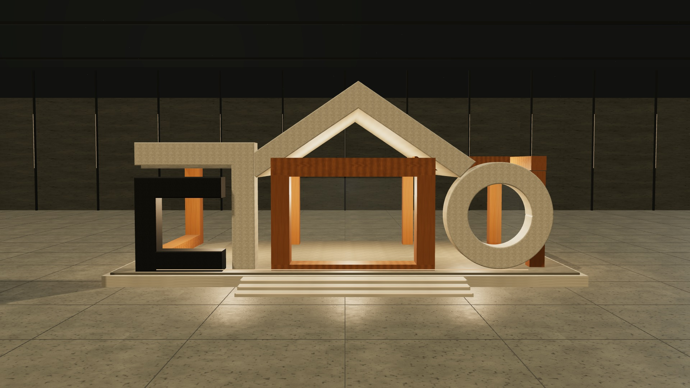

# 글자의 집

**A House of Hangul**

글자로 지은 집을 한 페이지에서 걸어 보는 온라인 전시입니다. 스크롤을 내리면 한글로 지은 건축관에서 출발해 글자 여섯 개를 만나고, 다시 돌아온 집의 정면에서 각 글자가 어디에 쓰였는지 봅니다.

[공개 전시 관람하기](https://hangul-house.mossyrobin64.chatgpt.site) · [GitHub 저장소](https://github.com/keepoki/hangul-house)



## 전하고 싶은 이야기

**한글의 여백에는 사람이 지나고, 빛과 풍경이 들어올 자리가 있습니다.**

매일 쓰는 글자를 건축의 눈으로 보면, 획과 획 사이에 남겨 둔 빈 곳의 역할이 달라집니다. ㄱ 아래에는 처마 그늘이 생기고, ㅁ의 안으로 사람이 드나듭니다. ㅇ 한가운데에는 둥근 창이 열리고, 서로 기댄 ㅅ 아래에는 잠시 머물 자리가 생깁니다. 전시가 끝난 뒤에도 익숙한 글자 하나쯤은 그 안의 여백부터 다시 바라보게 하고 싶었습니다.

## 관람 순서

1. **집**에서 건축관을 둘러봅니다. **구조 펼쳐 보기**를 열고 ㄱ·ㅁ·ㅅ·ㅇ을 누르면 각 획이 집의 어느 부분이 되는지 볼 수 있습니다.
2. 스크롤하거나 하단 글자를 눌러 여섯 전시 공간을 관람합니다.
3. **완성**에서 집을 정면으로 봅니다. 아래로 더 스크롤하면 같은 페이지에서 정면 사진 위로 건축의 윤곽이 그려지며 **전시 노트**가 이어집니다. 노트의 움직임도 스크롤 위치에 따라 진행되므로 위로 올려 같은 장면을 다시 볼 수 있습니다.

| 글자 | 전시 공간 | 볼거리 |
| --- | --- | --- |
| ㄱ | 돌의 방 | 석회암의 가로획이 처마를 만들고 세로획이 그 아래를 받칩니다. |
| ㅇ | 물의 뜰 | 청동 고리의 빈 가운데로 물과 빛이 이어집니다. |
| ㅁ | 나무의 뜰 | 참나무 네 획이 둘러싼 여백이 입구가 됩니다. |
| ㅎ | 빛의 방 | 조명이 옆으로 움직일 때 벽에 황동 조형물의 그림자가 맺힙니다. |
| ㅏ | 초록의 정원 | 전시 노트에서 세로획의 밑점을 축으로 ㅏ가 돌아갑니다. 반 바퀴에서는 ㅓ가 보이고 한 바퀴 뒤에는 ㅏ로 돌아옵니다. |
| ㅅ | 고요의 방 | 두 도자기 획이 서로 기대며 지붕 아래에 삼각형의 빈 공간을 만듭니다. |

상단 **관람 방식**에서 **자동**, **3D**, **이미지**를 선택할 수 있습니다. 자동 모드는 기기에 맞춰 3D 품질을 조절하고, 3D를 표시하기 어려우면 같은 순서의 고화질 전시 이미지로 이어갑니다. 데스크톱에서는 휠, 모바일에서는 터치로 관람할 수 있습니다. 기기에서 동작 줄이기를 켜면 전시 노트를 정지 이미지와 글로 읽을 수 있습니다.

## 로컬 실행

Git과 Node.js, npm이 필요합니다. 외부 패키지를 따로 설치할 필요 없이 아래 명령으로 실행할 수 있습니다.

```sh
git clone https://github.com/keepoki/hangul-house.git
cd hangul-house
npm run dev
```

브라우저에서 [로컬 전시 열기](http://localhost:4173). 서버를 종료하려면 실행한 터미널에서 `Ctrl+C`를 누릅니다.

| 명령 | 용도 |
| --- | --- |
| `npm test` | 자동 테스트 실행 |
| `npm run check` | JavaScript 모듈과 페이지 시작 코드의 문법 검사 |
| `node build-standalone.mjs` | 서버 없이 열 수 있는 `hangul-house.html`을 프로젝트 루트에 생성 |

## 제작과 출처

건축물, 조형물과 표면 질감은 코드로 구성했습니다. 이미지 관람에 쓰는 장면은 전시의 3D 공간에서 렌더링했습니다. 웹 전시는 HTML·CSS·JavaScript로 작성했고, 정적 배포 파일은 `dist/`에 있습니다.

- 3D 렌더링에는 Three.js를 사용했습니다. [MIT 라이선스](dist/assets/THREE-LICENSE.txt)
- 전시 노트의 스크롤 애니메이션에는 Motion Mini를 사용했습니다. [MIT 라이선스](dist/assets/MOTION-LICENSE.txt)
- 제목에는 고운바탕을 사용했습니다. [SIL Open Font License 1.1](dist/assets/FONT-LICENSE.txt)
